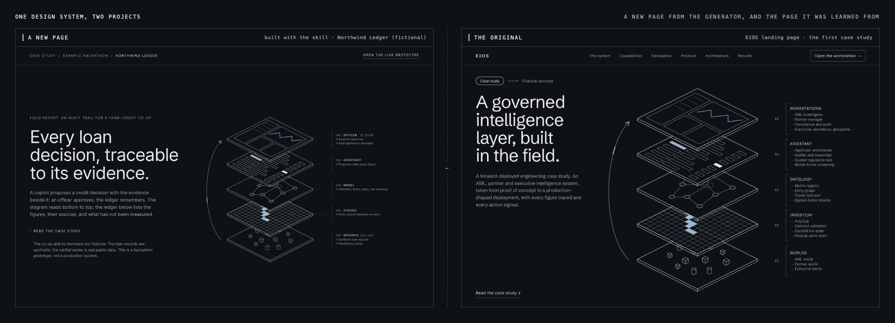
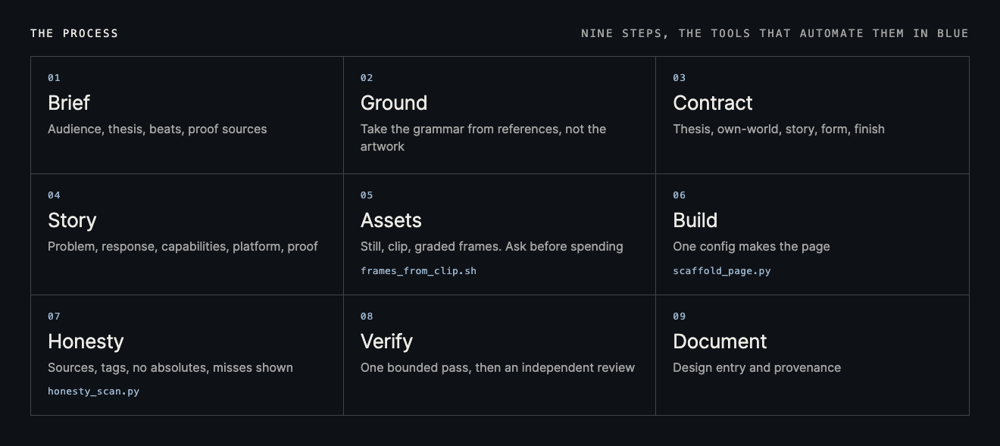
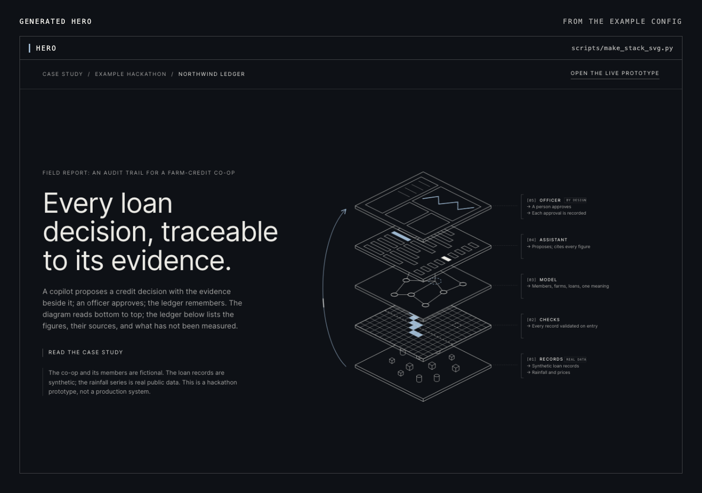
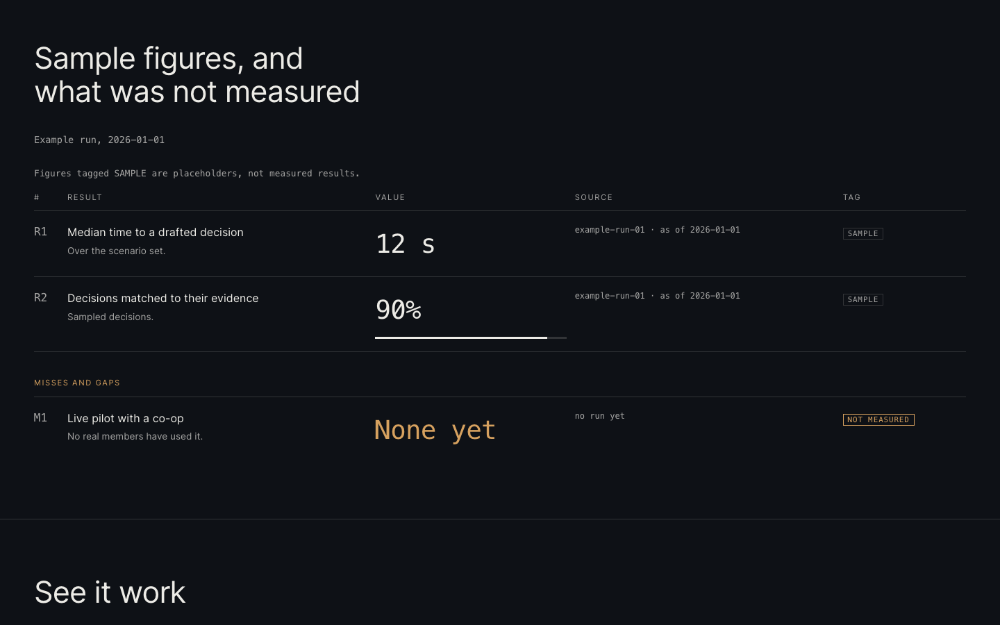
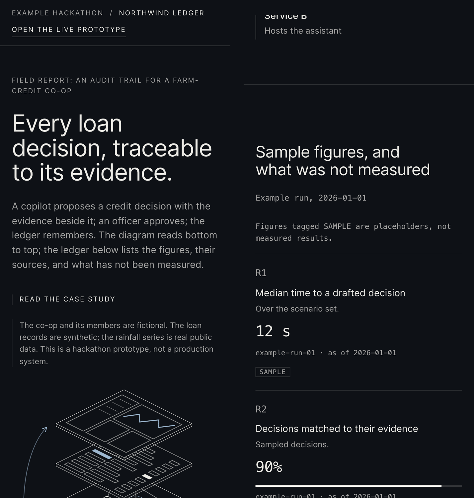
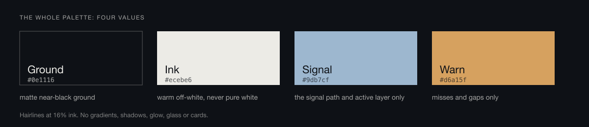
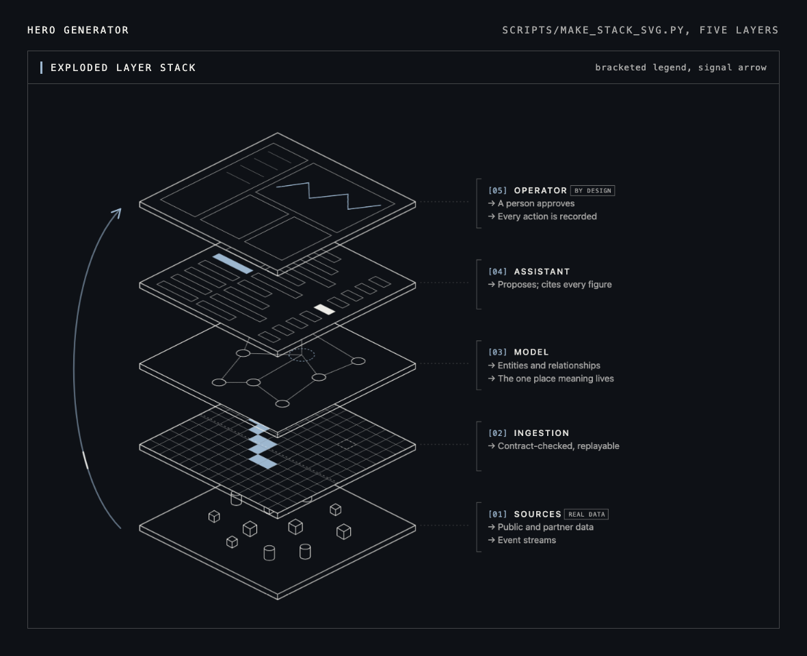
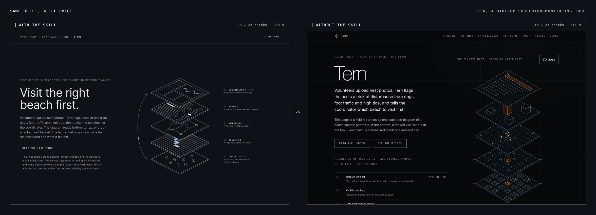
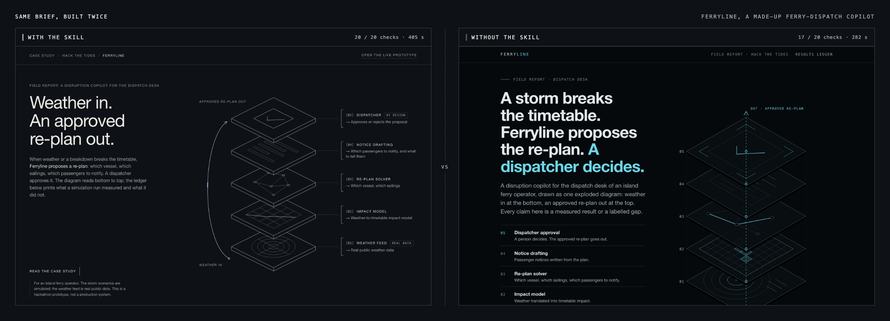

# Field Report

[](https://github.com/abdullahabtahi/field-report-skill/actions/workflows/test.yml)

A [Claude Code](https://claude.com/claude-code) skill that turns a project (built for a hackathon, a client or a demo) into a **forward-deployed-engineer case study page**: a dark, hairline, engineering-report look; one exploded diagram of the system as the hero; and an honest ledger of what was and was not measured.

The look is deliberately locked. Consistency across several case studies is the point: only the content, the hero object, the story and the generated assets change per project. Version 0.1, experimental (see [How well does it work](#how-well-does-it-work)).



*Right: the EIOS landing page, the first case study and the source of this design system. Left: a new page for a made-up project, generated with the skill. Same palette, type, legend grammar and exploded-stack hero; different content and layers.*

## The process



Claude follows these steps when you ask for a case-study page. Three have tools behind them: the frame cutter, the page generator and the honesty scan. Step 8 includes an independent finish review by a fresh agent, not the one that built the page.

## What it makes

The images below come straight from the generator, using the fictional example in [`examples/northwind-ledger/`](examples/northwind-ledger/) (sample figures, clearly tagged).



*The hero is an exploded stack of the system's layers, read bottom to top, with a bracketed legend and a signal arrow that carries one travelling dash.*



*The ledger gives every figure a source, an as-of date and a tag. Placeholders say `SAMPLE`, the heading follows the tags, and misses and gaps sit in the same table in the one warm colour.*



*On a phone the legend becomes a list under the diagram and the ledger stacks into cards, with no horizontal scroll.*

## The design system



Four values and hairlines. One signal colour for the signal path and the active layer; one warm colour that appears only on a miss or a gap. No gradients, shadows, glow, glass or cards. One grotesque at regular weight; mono only for figures, ids and tags. The reason for each rule is in [`design-world.md`](field-report-landing/references/design-world.md).



## It will not let you overclaim

Fill one config file and `scaffold_page.py` builds the whole page and a `results.json` from it, so a number on the page cannot drift from its data. If the config breaks the honesty rules it refuses and writes nothing. This is real output:

```text
ERROR headline: absolute 'never' (say what is checked and how)
ERROR no misses: a page with no gaps is not believed. List what was not measured or what failed (or set allow_no_misses with a reason).
ERROR R1: a MEASURED figure needs a source and an as_of date
ERROR R1: bar percentage 80 is not the printed value '90%'; a bar may draw only a printed number
4 errors: nothing written
WARN  lede: quantity word with no source ('hundreds'); give it a ledger row or reword: 'Volunteers file hundreds of photos.'
```

## What is in the box

| | |
|---|---|
| **Workflow** | `SKILL.md`: the steps above, the decisions that belong to you, and a list of known failure modes |
| **References** | the design world, story spine, Magnific asset recipe, build checklist, honesty rules, brief template and finish-review checklist, each rule with its reason |
| **Page generator** | `scripts/scaffold_page.py`: hero, problem and response, capabilities, platform, ledger with misses, close, plus `DESIGN-landing.md` and `PROVENANCE.md` |
| **Hero generator** | `scripts/make_stack_svg.py`: the exploded layer stack, 3 to 6 layers, five artwork styles |
| **Asset tools** | `scripts/frames_from_clip.sh` turns a generated clip into graded WebP frames; `references/asset-recipe.md` has the prompts that worked |
| **Checks** | `honesty_scan.py` (banned words, absolutes, numbers and quantity words outside data files), `asset_version_check.py` (cached rasters changed without a version bump) |
| **Building blocks** | design tokens, a direction-contract template, a windowed frame-sequence loader and hook for scroll-scrubbed canvases, style-reference frames for generating a hero |

## Install

Prerequisites: Claude Code and Python 3. For the optional generated hero you also need a Magnific account with its MCP connected, plus `ffmpeg` and `cwebp`. The skill calls the `impeccable` design skill for context and polish if you have it installed (optional, installed separately).

```bash
git clone https://github.com/abdullahabtahi/field-report-skill
ln -s "$PWD/field-report-skill/field-report-landing" ~/.claude/skills/field-report-landing
```

## Quick start

```bash
cd my-project
python3 ~/.claude/skills/field-report-landing/scripts/scaffold_page.py --example > landing.config.json
# edit landing.config.json: layers, problem, response, capabilities, ledger rows, misses
python3 ~/.claude/skills/field-report-landing/scripts/scaffold_page.py --config landing.config.json --out dist/
open dist/index.html
```

Or just ask Claude for a case-study landing page in this style. The example above is in [`examples/northwind-ledger/`](examples/northwind-ledger/) (config and built page).

## How well does it work

Two made-up briefs, each built with and without the skill and scored by an objective grader: **20/20 vs 17/20** and **23/23 vs 18/23**.





The skill's gain is fidelity to the design system and to the honesty rules, plus a page generator that cut the second build's time. A no-skill run is not weak and can build richer interaction. An independent finish review of a with-skill page found six real issues, whose causes are fixed in the generator and rules. Full results, grader changes and limits are in [`evals/RESULTS.md`](evals/RESULTS.md).

Not yet proven: automatic triggering (the trigger test returned 0% recall in its harness, so it says nothing either way), generated-hero builds, scroll sequences, interactive figures, or a real project end to end. Treat 0.1 as a strong starting point, not a finished product.

## Development

```bash
python3 -m unittest discover -s tests          # script tests
python3 docs/build_figures.py                  # rebuild the README figures from docs/src (needs Playwright)
```

## Notes

- Not affiliated with, or endorsed by, Palantir, QuantumBlack or any company named as a style reference. The skill borrows a visual grammar (layer diagrams, bracketed legends, hairline linework), not anyone's artwork.
- The bundled style-reference frames are the author's own generated art. Check your image tool's terms before redistributing generated images in your own fork.
- Licence: MIT.
